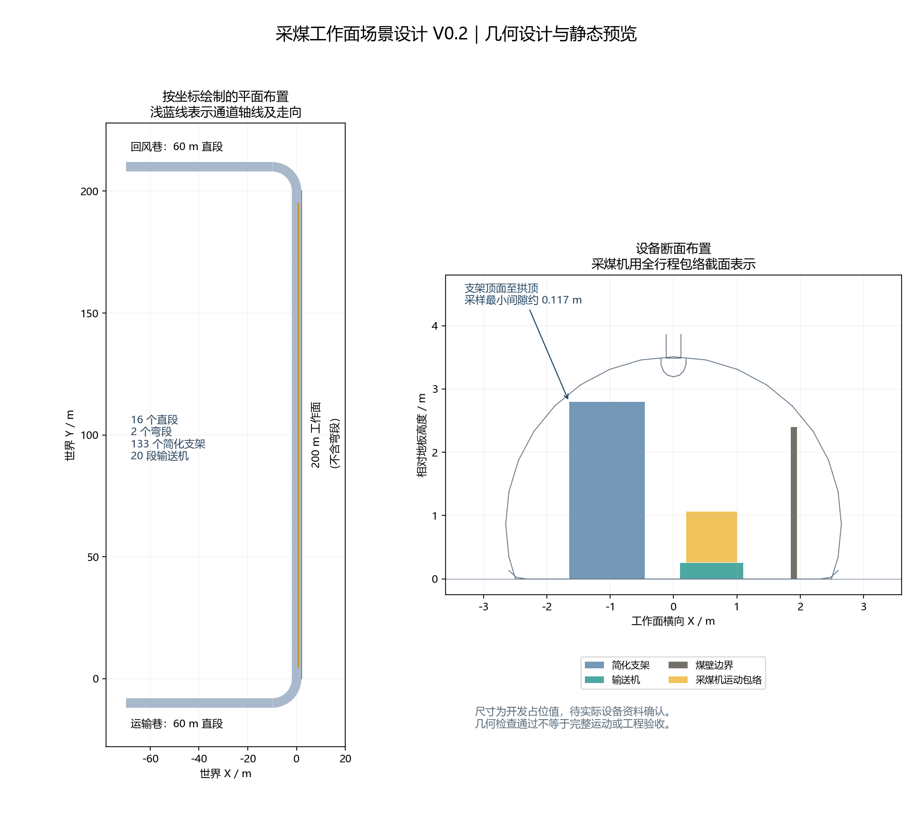

# 采煤工作面场景设计 V0.2

2026-10-28｜基于已下载 SubT 拼块的几何设计版。平面布置、设备占位尺寸和静态预览用于讨论及实施，尚未完成动态全链验收，不作为实际矿井设计。

## 1. 布局与尺寸

采用水平 U 形：200 m 直线工作面连接两条平行巷道。工作面长度取老师方案 200～300 m 的下限；两巷各 60 m 直段是开发暂定值。转接弯段放在工作面两端之外，因此两巷轴线间距为 220 m，不将其误写成工作面长度。



| 区域 | 世界坐标与尺寸 | 拼块 |
|---|---|---|
| 工作面 | 轴线 X=0，Y=0～200 m，地板 Z≈0.0005 m | Tile 5 直段 10 个，中心 Y=10、30…190 |
| 运输巷直段 | Y=-10 m，X=-70～-10 m，长 60 m | Tile 5 直段 3 个，中心 X=-60、-40、-20，绕 Z 转 90° |
| 回风巷直段 | Y=210 m，X=-70～-10 m，长 60 m | 同上，另放 3 个 |
| 运输侧转接 | Tile 2 放置在 (0,-10,0)，绕 Z 转 180° | 弯段 1 个，连接 (0,0) 与 (-10,-10) |
| 回风侧转接 | Tile 2 放置在 (0,210,0)，绕 Z 转 -90° | 弯段 1 个，连接 (0,200) 与 (-10,210) |

合计 **16 个直段＋2 个弯段**。当前没有四路交叉，不放置四岔口；两巷外端作为出入口，暂不放封堵块。已有岔口和封堵块继续保留在资源库。

定位依据：直段采用局部连接口 (0,-10,0)、(0,10,0)；弯段采用 (0,-10,0)、(10,0,0)。通过连接口位置和朝向匹配，再对端口内侧截面进行射线对照，检查尺寸是否相容；不使用模型外包围盒直接决定拼接距离。

## 2. 工作面设备横向布置

以下均为仿真占位尺寸，待师兄提供实际设备资料后替换。横向意图为“支架—输送机及采煤机—煤壁边界”。保留原 SubT 拱形通道作为简化工作面包络，尚未表达真实煤矿长壁截面。

| 设备 | 数量 | 尺寸（X×Y×Z，m） | 位置与说明 |
|---|---:|---|---|
| 简化液压支架 | 133 | 1.2×1.4×2.8 | 中心 X=-1.05；Y=0.75+1.5k，k=0…132；底部在地板上 |
| 刮板输送机 | 20 段 | 每段 1.0×10×0.25 | 中心 X=0.6；Y=5、15…195；只表达静态几何 |
| 简化采煤机 | 1 | 0.8×2.0×0.8 | 中心 X=0.6，Z=0.6605；距输送机顶面留 0.01 m，暂用运动学定位 |
| 煤壁边界 | 20 段 | 每段 0.1×10×2.4 | 中心 X=1.9；Y=5、15…195，表示工作面侧边界，不模拟破碎截割 |

与 V0.1 的主要调整：支架中心由“靠墙待定”落实到 X=-1.05 m，保持原占位外形，在拱形净空内重新定位。采煤机和输送机的 X 位置同步设为 0.6 m，避免与支架重叠。上述留距是几何布置结果，未按矿井工程安全标准设计。

## 3. 运动和接入条件

- 采煤机中心沿 Y=5～195 m 往复，机体扫掠范围为 Y=4～196 m，不进入转接弯段。
- 完整余弦往返周期暂定 1200 s，最高速度约 0.497 m/s。调试可使用短行程模式；完整行程与运动节点限位更新尚待实施。
- 保留 world、base_link、laser_link、imu_link 坐标约定；传感器外参与新机体高度同步更新。真值 50 Hz、激光 10 Hz、理想 IMU 50 Hz 为既有基线，须在正式大场景重测。
- 本人交付场景、运动、真值和接入条件；UWB/NLOS 与粉尘模型由对应师弟实现。预留安装位置和接口，不在此阶段另起模型开发。
- 后续增加 `/shearer/state` 工况接口。模拟截割标签服务于联调，不表示已实现截割物理。

## 4. 已做的几何检查

| 检查 | 结果 |
|---|---|
| 连接口配对 | 17 处相连，位置及方向匹配，仅余两巷外端两个开口 |
| 连接截面对照 | 每个端口在内侧 1 cm 处用 360 条射线比较，最大差异约 0.000169 m |
| 设备与通道 | 对 173 个静态箱体及采煤机全行程扫掠体做三角形/箱体相交检查；扣除允许的地板接触后未发现相交 |
| 设备相互重叠 | 所设计的箱体及运动扫掠体无体积重叠 |
| 支架拱顶间隙 | 在 133 架支架顶部共采样 6517 点，最小垂直间隙约 0.117 m |

检查方法与输入网格 SHA-256 见 `design_v02/geometric_checks.json`。碰撞相交检查采用已下载模型的实际几何；顶部间隙是离散采样值。几何检查不等同于动力学、地板承托、传感器遮挡质量或真实矿井合规验收。

## 5. 交付与下一步

- `design_v02/layout_parameters.json`：完整参数和设备实例。
- `design_v02/model_instances.csv`：18 个拼块的精确位姿。
- `worlds/coal_face_design_preview.sdf`：**静态预览**，采煤机暂不运动。
- `design_v02/场景设计图V0.2.png`：按坐标绘制的布局和设备断面。

Ubuntu22 中查看预览：

```bash
source /opt/ros/humble/setup.bash
python3 ~/coal_sim_ws/src/coal_face_sim/scenarios/coal_face_v1/tools/show_design.py
```

该入口使用独立 ROS 域和 Gazebo 端口；关闭窗口或 Ctrl+C 会停止预览。原有小场景和启动入口保留。

下一阶段将此设计转为正式 `coal_face.sdf`：适配长行程控制、挂载已有真值与传感器、添加工况接口、验证接缝碰撞及完整往返，并记录频率、时间同步和性能。

向师兄确认：有没有实际平面图和断面图；200 m＋两条 60 m 直巷是否适合作为首版；支架间距和设备尺寸是否有必须采用的值。确认前，各设备尺寸仍是开发占位值。
